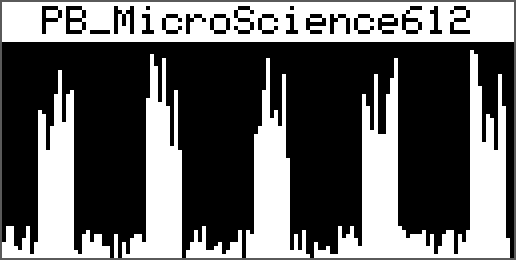
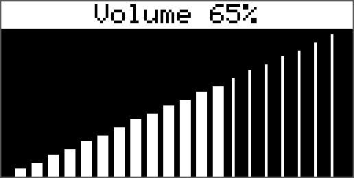
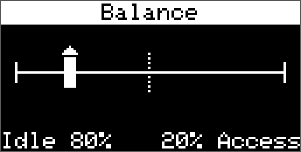
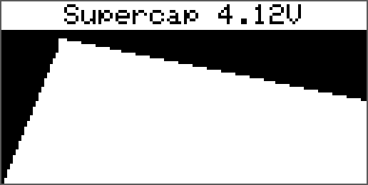
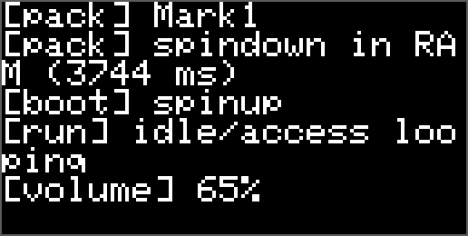

# HDDSynth Native

Native C++ firmware for the [HDD Synth](https://github.com/MaverickUK/HDDSynth) MK5 board (RP2354A), replacing the CircuitPython firmware. Licensed under GPLv3, like the HDD Synth software.

## Status

A dual-core C++ firmware for the MK5 HDD Synth (RP2354A), replacing the
CircuitPython firmware. It has passed hardware testing (steady state,
stress, SD card removal, simulated power loss, every pack on the test card)
and has feature parity with the CircuitPython firmware, plus a few extras.

- SD-streamed spinup, idle and access; spindown from RAM (or SD if it is
  too big); power-loss spindown from the supercap.
- Rotary encoder volume / balance, action button (next pack, factory
  reset), beeps with RGB LED flashes, saved pack choice, first-boot jingle,
  `RANDOM_SAMPLE_PACK`.
- Demo mode, a rainbow light show during the jingle, a
  power-loss log on the SD card, and recovery from SD card removal without
  a reboot.
- OLED display support
- Modelled drives: a pack can be a physics model of a drive instead of
  recordings (`drive.json`), synthesised live (see
  [Modelled drives](#modelled-drives-drivejson)).

## Architecture

| Core | Owns | Never does |
|---|---|---|
| **Core 1** | Mixer and I2S output. Reads RAM only. | Touch the SD card, block, allocate |
| **Core 0** | SD card (sole owner), power monitoring, LEDs, activity, serial console | Generate audio |

The two cores share only lock-free ring buffers (about 1 s of audio per
streamed voice) and a small per-voice state handshake (see `src/mixer.h`).
Because only core 0 ever touches the SD card, the CircuitPython race cannot
occur. An SD stall or read error just drains the ring while core 0 retries
or re-initialises the card.

- **Samples:** only the spindown is held in RAM; everything else streams
  from SD (see below).
- **Power loss** comes from the eFuse FLT pin: an interrupt plus a 3 ms
  confirmation, instead of 50 ms+ polling.
- **Safety:**
  - Hardware watchdog (2 s), fed only while the audio core's heartbeat is
    advancing.
  - SD transfers are CRC-checked (`USE_SD_CRC=1`).
  - Level changes ramp over one 8 ms block, so there are no clicks.

### Where each sound plays from

| Sound | Plays from | Loaded |
|---|---|---|
| Idle | SD, streamed through its own 32 KB buffer (~1 s) | Buffer filled while the spinup plays, so RUN starts seamlessly; topped up continuously |
| Access | SD, streamed through its own 32 KB buffer (~1 s) | As idle. It plays all the time; HDD activity only changes its volume. After each burst it silently jumps to a random point, so regular activity doesn't keep hearing the same part of the loop |
| Spinup | SD, streamed through a shared 32 KB "one-shot" buffer | At boot |
| Jingle | SD, streamed through the one-shot buffer | First boot, before the spinup |
| Spindown | **RAM**, the whole file, if it fits; otherwise SD through the one-shot buffer | When the pack loads (boot or pack change); the previous pack's copy is freed first |
| Beeps | Neither: the audio core synthesises each sample as it plays | n/a |
| Modelled drive | Neither: the audio core synthesises it (`drive.json` packs) | Its engine (2.9 KB) is allocated when the pack loads, and freed when it unloads |

**Why the spindown is in RAM:** it plays while the power is failing,
running off the supercap. From RAM it starts instantly and needs nothing
else to keep working. Streaming would rely on the SD card reading reliably
while the supply sags. The other sounds play with power present, and
streaming them keeps RAM free for the spindown.

**When it fits:** the spindown is loaded only if at least 32 KB of memory
is still free afterwards (`HEAP_RESERVE_BYTES`, a margin for everything
else). About 391 KB is free before it loads, so the largest spindown that
fits is about 359 KB. How long that is depends on the pack's sample rate
(mono 16-bit is 2 bytes per sample):

| Pack sample rate | Data per second | Longest spindown in RAM | Stream buffer cover |
|---|---|---|---|
| 16 kHz | 32 KB | ~11.2 s | ~1.0 s |
| 22.05 kHz | 44 KB | ~8.1 s | ~0.74 s |
| 32 kHz | 64 KB | ~5.6 s | ~0.51 s |
| 44.1 kHz | 88 KB | ~4.1 s | ~0.37 s |
| 48 kHz | 96 KB | ~3.7 s | ~0.34 s |

("Stream buffer cover" is how long each streamed sound can ride out a
slow SD read.) Every current pack is 16 kHz and fits; the largest,
`PB_MicroScience612` (11.0 s), leaves about 6 KB to spare (13 KB before
the modelled drive's code moved into RAM, v0.20.0). With
`EXPERIMENTAL_HDDSYNTHPRO_SUPPORT` on, `sequential.wav`'s 32 KB buffer means
it streams instead. The boot log says which happened:
`spindown in RAM (… ms)` or `spindown will stream from SD`.

**If it doesn't fit:** once running, the one-shot buffer is kept
pre-filled with the start of the spindown, so it still starts instantly on
power loss and the rest streams while it plays. One weak spot: during the
spinup and jingle that buffer is busy, so a power cut then has to fill it
first (a short SD read before the spindown starts). No current pack is
affected. `pio run -e mk5_stream_test` builds a variant that always
streams the spindown, to test this path.

**Memory overall:** the three 32 KB buffers (96 KB) and the rest of the
firmware permanently use about 125 KB of the 512 KB, leaving the ~391 KB
the spindown draws from. Features that add RAM shrink the space for big
spindowns.

## SD card

```
/settings.json            optional, see below
/jingle.wav               optional, played once on first boot
/samples/<pack>/spinup.wav
/samples/<pack>/idle.wav
/samples/<pack>/access.wav
/samples/<pack>/spindown.wav
/samples/<pack>/pack.json optional, see below
/samples/<pack>/sequential.wav  optional, see HDDSynthPro activity link
/samples/<pack>/drive.json      a modelled drive instead of the WAVs, see below
/powerlog.bin             created by the firmware (power-loss log)
/state.bin                created by the firmware (saved volume/balance)
```

The layout and `settings.json` keys are the same as the CircuitPython
firmware, so existing cards keep working. A pack is any folder in
`/samples` (name up to 63 characters); packs are used in alphabetical order.

**WAV files:** mono, 16-bit PCM at **16000, 22050, 32000, 44100 or 48000
Hz**. All of a pack's WAVs must use the same rate (the audio output
switches to it when the pack loads); a pack that mixes rates is reported as
broken, and the log names the mismatched files. The jingle may use any of
those rates. Higher rates sound crisper but cost RAM and SD bandwidth: the
spindown that fits in RAM gets shorter (from ~11 s at 16 kHz to ~4 s at 48
kHz; see the table under [Where each sound plays from](#where-each-sound-plays-from)).
22.05 or 32 kHz gets most of the benefit through a small speaker. Any
length otherwise: everything else streams from the card.
Metadata that editors add before the audio (`bext`, `LIST`, markers) is
fine, as long as the audio starts within the first 4 KB of the file. A file
that breaks these rules is reported as a broken pack (4 low beeps).

### pack.json (optional, per pack)

A pack can carry its own settings in `/samples/<pack>/pack.json`. Every key
is optional:

```json
{
    "NAME": "IBM Ultrastar 36LZX",
    "AUTHOR": "PB",
    "GAIN": 1.4,
    "ACTIVITY_LED_COLOUR": "#FF8800",
    "BALANCE_DEFAULT": 0.3
}
```

| Key | Default | What it does |
|---|---|---|
| `NAME` | the folder name | Shown on the OLED's title bar. |
| `AUTHOR` | *(none)* | Credited in the boot log. |
| `GAIN` | `1.0` | Loudness trim for this pack's sounds (spinup, idle, access, spindown), 0.0 to 2.0, to even out packs recorded at different levels. Doesn't affect beeps or the jingle. |
| `ACTIVITY_LED_COLOUR` | settings.json's | This pack's activity LED colour (`"#RRGGBB"` or `[r, g, b]`). Demo mode's random colour still wins. |
| `BALANCE_DEFAULT` | settings.json's / 0.5 | This pack's starting balance, since packs differ in how loud idle is against access. A `BALANCE_DEFAULT` in settings.json overrides it, and so does a saved balance at boot (`SAVE_VOLUME_BALANCE`). On a pack change, the new pack's value applies. |

### Modelled drives (drive.json)

A pack can be a **model of a drive** instead of recordings: put a
`drive.json` in its folder (the WAVs are then ignored, and can be left
out). The firmware synthesises the drive live on the audio core:

- **The spindle** spins up and coasts down with real dynamics: rotation hum
  at rpm/60 Hz, the motor's whine at rpm/60 × slots (loudest while it
  works hard, so the spin-up rises then settles), bearing noise and the air
  dragged round by the platters.
- **A virtual head** seeks with real actuator physics. A voice coil
  accelerates at full force and brakes at full force (bang-bang), so short
  seeks tick and long ones clunk, and each force change rings the arm and
  case. A stepper clicks once per cylinder. Power-on unparks and calibrates;
  power-off parks (with the latch's clack) and coasts down.
- **HDD activity** sets a virtual workload: random access, or a file copy
  (sequential, with trips to the FAT). The head's pace is a real drive's:
  each random access waits for the seek and for the sector to come round.
  A plain HDD LED can't say which kind of access it is, so activity that
  stays on for 1.5 s counts as a file copy; with the HDDSynthPro link or
  the companion app, their own class decides.

Volume, the pack's `GAIN`, `PLAY_SPINUP`, `PLAY_IDLE`, `PLAY_SPINDOWN`,
standby and demo mode all work as with recorded packs. **Balance** mixes the
running sound (spindle, bearing, air) against the seeks (actuator, servo);
at 0.5 both are at full level.

The easiest way to make one is the **Drive Lab**, online at
<https://maverickuk.github.io/HDDSynth_Native/drive-lab/> (source in
[`tools/drive-lab`](tools/drive-lab)): tune the drive by ear, with a real
pack's WAV alongside to compare, and download its `drive.json`.
The smallest drive.json names a built-in preset:

```json
{ "format": "hddsynth-drive", "version": 1, "name": "1997 voice coil",
  "preset": "voice97", "sampleRate": 32000, "params": { "rpm": 5400 } }
```

| Key | Default | What it does |
|---|---|---|
| `preset` | `voice97` | Starting parameters: `stepper85` (1985, 5.25″ MFM stepper, 3600 rpm), `voice91` (1991, 3.5″ voice coil, 3600 rpm, landing zone), `voice97` (1997, 5400 rpm, thermal recalibration) or `fdb05` (2005, 7200 rpm, fluid bearing, ramp load). |
| `sampleRate` | `32000` | The output rate while the pack plays: 16000, 22050, 32000, 44100 or 48000. The engine takes about a quarter of the audio core at 32 kHz. |
| `name` | *(none)* | Logged at load (`pack.json`'s `NAME` still names the pack). |
| `params` | *(none)* | Any of the parameters below, overriding the preset's. Unknown keys and bad values are logged and skipped. |

The parameters (numbers are clamped to their range):

| Group | Parameters |
|---|---|
| Spindle | `rpm` (1800-15000), `spinupS` (1-20 s), `coastS` (2-30 s, the coast-down and so the spindown's length), `slots` (6-18), `polePairs` (2-8), `whine`, `hum`, `imbalance` (0-1) |
| Platters and air | `platters` (1-10), `size` (`"5.25"`, `"3.5"`, `"2.5"`), `windage` (0-1), `zoned` (true: LBA 0 at the outer edge, with more sectors per track there) |
| Bearing | `bearing` (`"ball"`, `"fdb"`), `wear`, `bearingLvl` (0-1) |
| Actuator | `actuator` (`"voice"`, `"stepper"`), `cylinders` (300-100000), `tick` (0-1, the track-to-track tick); voice coil: `fullStrokeMs` (8-60), `trackMs` (0.5-8), `settleDamp` (0.1-1.2), `buzz` (0-1); stepper: `stepMs` (0.2-6), `stepRamp` (0-1, buffered seeks) |
| Resonance | `armHz` (200-4000), `armRingMs` (5-200), `caseHz` (80-1200), `caseRingMs` (10-400), `hardness` (0-1) |
| Head events | `park` (`"ramp"`, `"zone"`, `"none"`), `calSeeks` (0-8), `recalS` (0-120 s, 0 off), `wedges` (0-400 servo wedges), `servo` (0-1) |
| Enclosure | `mount` (`"bare"`, `"case"`, `"sled"`), `bright` (-1 to 1), `caseRes` (0-1) |
| Mixer | `gSpindle`, `gBearing`, `gWind`, `gAct`, `gServo` (0-1.5, per layer), `master` (0-1.5) |

The spindown on a power cut is the coast-down: `coastS` long, entirely
from RAM, like a recorded spindown in RAM. The serial `t` stress test
exercises SD streaming, so it isn't available with a modelled pack.

### settings.json

Every key is optional; anything missing (or of the wrong type) keeps its
default. For example:

```json
{
    "SAMPLE_PACK": "Mark1",
    "VOLUME_DEFAULT": 0.9,
    "BALANCE_DEFAULT": 0.2,
    "ACCESS_HOLD_TIME_MS": 500,
    "ACTIVITY_LED_COLOUR": "#00FF00"
}
```

| Key | Default | What it does |
|---|---|---|
| `SAMPLE_PACK` | *(none)* | Pack to play (a folder name in `/samples`). Wins over the pack chosen with the action button. If it doesn't exist, the firmware beeps 5 times and carries on with another pack. |
| `RANDOM_SAMPLE_PACK` | `false` | Pick a random pack at every boot, never the same one twice running. Overrides `SAMPLE_PACK`. |
| `VOLUME_DEFAULT` | `0.5` | Starting volume, 0.0 to 1.0. If set, it is used at every boot, even over a saved volume. |
| `BALANCE_DEFAULT` | `0.5` | Starting idle/access mix: 0.0 = idle only, 1.0 = access only. Idle plays at volume × (1 − balance), access at volume × balance. The spinup and spindown play at the idle level, as in the CircuitPython firmware, so the hand-overs never change volume (and they're silent at 1.0). If set, it is used at every boot, even over a saved balance. |
| `SAVE_VOLUME_BALANCE` | `false` | Remember the volume and balance when you change them (2 s after the last change), and use them at the next boot unless `VOLUME_DEFAULT`/`BALANCE_DEFAULT` is set. Saved on the SD card in `/state.bin`, so they go with the card. A factory reset clears them. *(New.)* |
| `PLAY_SPINUP` | `true` | Play the spinup at boot. |
| `PLAY_IDLE` | `true` | Play the idle loop. |
| `PLAY_SPINDOWN` | `true` | Play the spindown on power loss. |
| `ACCESS_HOLD_TIME_MS` | `100` | How long the access sound keeps playing after the HDD activity signal stops. |
| `SIMULATION_MODE` | `false` | Fake random HDD activity instead of reading the activity input. |
| `POWER_DETECTION` | `true` | Watch the eFuse for power loss. Set `false` to run from USB with no power-loss detection. |
| `ACTIVITY_LED_ENABLED` | `true` | Light the RGB LED on HDD activity. |
| `ACTIVITY_LED_COLOUR` | `"#00FF00"` | Activity LED colour, as `"#RRGGBB"` or `[r, g, b]` (0-255 each). |
| `RGB_LED_BRIGHTNESS` | `0.5` | Overall RGB LED brightness, 0.0 to 1.0 (applies to beeps and the jingle show too). |
| `ALWAYS_PLAY_JINGLE` | `false` | Play `/jingle.wav` at every boot, not just the first. *(New: a code constant in CircuitPython.)* |
| `DEMO_MODE` | `false` | Demo mode, see below. *(New.)* |
| `STANDBY_MINUTES` | `0` (off) | Spin down after this many minutes without HDD activity, like a real drive's power management: the spindown plays and the board goes quiet. The next HDD access spins it up again (spinup, then idle/access). A short press of the action button changes pack and spins up. Ignored in demo mode. *(New.)* |
| `OLED_ENABLED` | `false` | Use an SSD1306 128x64 I2C OLED on header J6, see [OLED display](#oled-display). *(New.)* |
| `OLED_MODE` | `"activity"` | The OLED's main screen: `"activity"`, `"supercap"` or `"debug"`. *(New.)* |
| `OLED_SAMPLE_MS` | `1000` | Time covered by each column of the activity and supercap graphs (minimum 50). *(New.)* |
| `EXPERIMENTAL_HDDSYNTHPRO_SUPPORT` | `false` | Listen for the activity link from an HDDSynthPro on J6 and play `sequential.wav` during sequential transfers, see [HDDSynthPro activity link](#hddsynthpro-activity-link-experimental). Turns the OLED off (same header). *(New, experimental.)* |
| `SEQUENTIAL_LED_COLOUR` | `"#FF1800"` (orange) | Activity LED colour during sequential transfers, with `EXPERIMENTAL_HDDSYNTHPRO_SUPPORT` on (a debugging aid). Same format as `ACTIVITY_LED_COLOUR`. *(New.)* |

**Demo mode:** each pack spins up, plays idle/access with simulated HDD
activity for 60 seconds, plays its spindown, and hands over to the next
pack, looping forever. Each pack gets a random activity LED colour. A short
press of the action button skips to the next pack. Demo pack changes are
not saved, so after a power cut it starts again from the usual pack.

## OLED display

An optional SSD1306 128x64 I2C OLED (e.g. The Pi Hut's 0.96" module, address
0x3C) plugs straight into header **J6**: pin 1 3.3 V, 2 GND, 3 SCL (GP25),
4 SDA (GP24). The board has no I2C pull-ups on J6; these modules carry their
own. Turn it on with `"OLED_ENABLED": true`. If no display answers, the boot
log says so and the firmware carries on without it.

`OLED_MODE` picks the main screen:

| Mode | Shows |
|---|---|
| `activity` (default) | The pack name in a title bar, and a graph of HDD activity: one column per `OLED_SAMPLE_MS`, its height the share of that time the drive was active. New columns appear on the right and push the rest left. |
| `supercap` | The same graph for the supercap voltage (full height = 4.2 V), with the current voltage in the title bar. |
| `debug` | The last 8 lines of console output (everything printed to the USB serial console). |

Whatever the mode, turning the **volume** or **balance** switches to a screen
for that level, which stays for 4 seconds after the last change. The display
switches off on power loss, to save the supercap's energy for the spindown.

| Activity | Volume | Balance |
|---|---|---|
|  |  |  |

| Supercap | Debug |
|---|---|
|  |  |

These are rendered by the host tests from the same drawing code the firmware
uses (with made-up data). To regenerate them:
`HDDSYNTH_PREVIEW_DIR=docs/oled test/run_native_tests.sh && python3 test/pbm_to_png.py docs/oled`.

## HDDSynthPro activity link (experimental)

[HDDSynthPro](https://github.com/MaverickUK/HDDSynthPro) emulates an IDE
hard disk, so it knows exactly what the drive is doing, not just when its
activity LED is lit. With `"EXPERIMENTAL_HDDSYNTHPRO_SUPPORT": true` the
HDD Synth listens for it on header **J6** (instead of an OLED):

| J6 pin | Signal | Connect to |
|---|---|---|
| 1 | 3.3 V | nothing: each board has its own supply |
| 2 | GND | HDDSynthPro GND |
| 3 | GP25, UART1 RX | HDDSynthPro's link TX, through a 1 kΩ resistor at its end |
| 4 | GP24, UART1 TX | nothing (reserved) |

It's a one-way UART at 115200 baud, 8N1, carrying lines like
`$HDA,1,1,S,R*4C` (busy, sequential, reading); the protocol is in
HDDSynthPro's `docs/activity-link.md`. While valid lines arrive:

- the link's busy flag drives the access sound instead of the activity
  input (with the same `ACCESS_HOLD_TIME_MS` release);
- during **sequential** transfers (e.g. a large file copy) the pack's
  `sequential.wav` plays instead of `access.wav`, and the activity LED turns
  `SEQUENTIAL_LED_COLOUR` (orange by default). A pack without
  `sequential.wav` plays `access.wav` throughout.

`sequential.wav` is optional and follows the same rules as `access.wav`
(the same format and sample rate as the pack's other files, a seamless
loop). After a second without a valid line the link counts as lost and the
activity input takes over again; the log says `[link] up` and `[link] lost`.
The `s` stats include the link's state and counts of valid and rejected
lines.

To try it without an HDDSynthPro: with `SIMULATION_MODE` on, one simulated
burst in three becomes a longer sequential spell. Or connect a 3.3 V
USB-serial adapter's TX to J6 pin 3 (and GND to pin 2) and paste lines such
as `$HDA,1,1,S,R*4C` (busy, sequential) and `$HDA,1,0,I,-*28` (idle).

## Companion app: your computer's disk activity over USB

Plug the HDD Synth into a Mac or PC with a USB cable and run the
[**HDD Synth Companion**](companion/README.md), a tray (menu bar) app. It
sends the computer's own disk activity, so the HDD Synth needs no HDD LED
wiring. From its menu and settings window you can also choose the sample
pack and set the volume and balance. It's a Python app installed with one
`pipx` command, unsigned and needing no admin rights; see
[companion/README.md](companion/README.md).

The app's activity is added to the activity input (and to the HDDSynthPro
link): either one plays the access sound. Nothing needs turning on in
settings.json. Large file copies count as sequential transfers, which play
`sequential.wav` when `EXPERIMENTAL_HDDSYNTHPRO_SUPPORT` is on. Over USB the
board is powered by the computer, so a power-loss spindown happens when the
computer cuts USB power (shutdown, or sleep on some machines). Set
`POWER_DETECTION` to `false` if that isn't wanted.

### Protocol

The app talks over the board's USB serial console (115200 baud). Any line
starting with `$` is a protocol sentence; everything else is the normal
console, so the single-key commands still work from a terminal while the app
isn't running. Sentences use the same format as the HDDSynthPro link:
`$<fields>*<checksum>`, where the checksum is two hex digits, the XOR of
every byte between `$` and `*`.

| Direction | Sentence | Meaning |
|---|---|---|
| app → board | `$HDA,1,<busy>,<class>,<op>` | Disk activity: busy `0`/`1`; class `I` idle, `S` sequential, `R` random; op `R`, `W` or `-`. Sent on every change and every 200 ms; after 1 s without one the board stops using it. |
| app → board | `$HDQ,1,STATUS` | Ask for `$HDS`. |
| app → board | `$HDQ,1,PACKS` | Ask for the pack list (`$HDP` for each pack). |
| app → board | `$HDC,1,VOL,<0-100>` | Set the volume (saved like an encoder change). |
| app → board | `$HDC,1,BAL,<0-100>` | Set the balance. |
| app → board | `$HDC,1,PACK,<index>` | Switch to that pack (as the action button does, remembered). Only in RUN or STANDBY, and not in demo mode. |
| board → app | `$HDS,1,<firmware>,<state>,<packIndex>,<packCount>,<volume>,<balance>,<supercapMv>` | Status. Also sent unprompted when the pack, volume, balance or state changes (at most every 250 ms) while the app is connected. |
| board → app | `$HDP,1,<index>,<count>,<folder>,<name>` | One pack: its folder and its pack.json `NAME` (or the folder), each up to 32 characters, with `,`, `*` and `$` replaced by `_`. |
| board → app | `$HDK,1,<VOL\|BAL\|PACK>,<OK\|ERR>,<reason>` | Reply to a command; reasons are `busy`, `demo` and `range`. |

For example `$HDQ,1,STATUS*78` and `$HDC,1,VOL,55*07` can be pasted into a
serial terminal to try it.

## Editing the SD card over USB

You don't need to take the card out to change packs or settings.json:

1. **Hold the action button while powering on** (or while tapping RESET),
   for about a second. The RGB LED turns **solid blue** and the OLED, if
   fitted, shows "USB drive".
2. The SD card appears on the computer as a drive (named after the card's
   volume label). No audio plays in this mode.
3. Copy packs in, edit settings.json, and so on (about 450 KB/s each way).
4. **Eject the drive** on the computer. The board reboots into normal use
   with the changes. (Pressing the action button also reboots it; eject
   first so the computer has finished writing.)

macOS may spend a while indexing a newly shared card with Spotlight; an
eject waits until it has finished.

## Controls

- **Rotary encoder:** turn for volume (5% steps); press to switch to balance
  (10% steps) and back. Remembered across power cycles only with
  `SAVE_VOLUME_BALANCE`.
- **Action button:** held at power-on = share the SD card over USB (see
  above). Short press (under 1 s) = next sample pack, remembered
  across power cycles. Hold 3 s = factory reset: forgets the chosen pack,
  the jingle flag and the saved volume/balance, then reboots. A press between 1 and 3 s does nothing.

## Lights and beeps

The RGB LED flashes in time with each beep: **blue** for something you
did, **red** for an error. Operation beeps are high-pitched, error beeps
low.

| Beeps | LED | Meaning |
|---|---|---|
| 2 short, high | 2 blue flashes | Encoder now adjusts **volume** |
| 3 short, high | 3 blue flashes | Encoder now adjusts **balance** |
| 1 short, high | 1 blue flash | Changing to the next sample pack |
| 1 long (1 s), high | 1 long blue flash | Factory reset, then a reboot |
| 1 low | red, repeating | **No SD card** (or it can't be read). Halted. |
| 2 low | red, repeating | **No sample packs** in `/samples`. Halted. |
| 4 low | red, repeating | **Broken pack**: `idle.wav`/`access.wav` missing or not 16 kHz mono 16-bit. Halted. Holding the action button 3 s (factory reset) forgets a saved broken pack. |
| 5 low | 5 red flashes, once | `SAMPLE_PACK` in settings.json **not found**. A warning: it carries on with another pack. |

"Halted" errors keep repeating their flash pattern on the red LED every
4 seconds, so a unit with no speaker attached still says what's wrong.
Beeps follow the volume setting, so they're never much louder than the drive
sound, but stay audible (at least 25%) even at very low volumes.

The rest of the time the RGB LED shows:

| LED | When |
|---|---|
| Activity colour (default green, `ACTIVITY_LED_COLOUR`) | HDD activity, real or simulated. Off when idle. `ACTIVITY_LED_ENABLED: false` turns this off. |
| A random colour per pack | HDD activity in demo mode. |
| Sequential colour (default orange, `SEQUENTIAL_LED_COLOUR`) | Sequential transfers reported by an HDDSynthPro (`EXPERIMENTAL_HDDSYNTHPRO_SUPPORT`). |
| Rainbow, pulsing with the sound | While the jingle plays. |
| Off | During the spindown, and once power is lost. |

`RGB_LED_BRIGHTNESS` scales all of these. The separate external HDD LED
output (GP17) also lights on HDD activity.

## Build and flash

**Flash a board with the latest release** (needs the GitHub CLI, `gh`):

```sh
scripts/flash-latest.sh           # or: scripts/flash-latest.sh v0.14.0
```

It downloads the release UF2, waits for the board's RP2350 drive (a blank
board shows it straight away; otherwise hold BOOT, tap RESET), copies the
firmware on and checks the board comes back as HDDSYNTH.

**Ready-made UF2s:** download `hddsynth-mk5-vX.Y.Z.uf2` from the
[latest release](https://github.com/MaverickUK/HDDSynth_Native/releases/latest).
GitHub Actions builds every push (the UF2 is in the run's artifacts) and
publishes a release for every `vX.Y.Z` tag.

To build it yourself, one-time setup: VS Code + the PlatformIO extension (or `pip install platformio`).

```sh
pio run                  # build -> .pio/build/mk5/firmware.uf2
pio run -t upload        # build and flash
pio device monitor       # serial console, 115200
```

**First flash** (the board is running CircuitPython):
1. Hold **S2 (BOOT)**, tap **S1 (RESET)**, release S2.
2. A drive called `RP2350` appears.
3. Run `pio run -t upload`, or drag `firmware.uf2` onto the drive.

After that, uploads reset the board into the bootloader automatically. The
serial command `b` also does it.

While the firmware runs, the board appears over USB as **HDDSYNTH** (by
"HDD Synth"). The `RP2350` drive name in bootloader mode comes from the
chip's boot ROM and doesn't change.

**Back to CircuitPython:** same BOOT/RESET dance, then drag the CircuitPython
UF2 back on. Your CIRCUITPY files are untouched by this firmware.

### Versioning

The firmware follows [Semantic Versioning](https://semver.org). The version
lives in `src/version.h`, is printed at boot and by the `h` command, and each
release commit is tagged `vX.Y.Z`.

- **MAJOR:** incompatible changes to the SD card layout or `settings.json`.
- **MINOR:** new features that stay backwards compatible.
- **PATCH:** bug fixes only.

While the version is `0.y.z`, anything may change between minor versions.

### Unit tests (runs locally, not on HDD Synth hardware)

```sh
test/run_native_tests.sh ../HDDSynth_Samples   # optional: path to sample packs
```

Covers:
- WAV parsing, including every file in the sample pack repo.
- The ring buffer and the mixer, under AddressSanitizer/UBSan.
- Two-thread producer/consumer tests that mirror core 0 and core 1.
- Beep synthesis, encoder decoding, button timing, the saved-state and
  power-log formats, and the jingle light show's level follower.
- The modelled drive: spin-up and coast-down times, seek physics, the
  workloads' pace, balance, parameter updates and the two-core handover.
  With node installed, it also renders the same scenario on the firmware's
  engine and the browser prototype's (`tools/drive-lab/compare.js`) and
  checks that they agree.

GitHub Actions runs them on every push.

## Serial console

```
h  help
s  stats now (also printed every 5 s in RUN)
t  stress test on/off: restarts streamed voices every 30-250 ms
p  simulate power loss (runs the spindown path)
a  toggle simulated HDD activity
+  / -  volume
>  / <  balance (towards access / towards idle)
n  next sample pack (same as a short press of the action button; remembered)
l  print the log of the last power loss (kept on the SD card)
k  play the next beep profile (to audition them)
d  list the SD card's root directory
m  demo mode on/off (as DEMO_MODE, not saved)
o  next OLED mode: activity, supercap, debug (not saved)
z  go into standby now (as if STANDBY_MINUTES had passed)
j  replay the jingle (clears its flag and reboots)
r  reboot
b  reboot into the USB bootloader
$  a line starting with $ is the companion app's protocol (see above)
```

Stats lines look like:

```
[stats] t=65s state=RUN heap=301234 mix_max=95us i2s_underflow=0 | idle: on under=0 min_ring=871ms | access: on under=0 min_ring=902ms | spindown: off under=0 min_ring=-
[stats] sd: chunks=4120 read_err=0 recoveries=0 failed_rec=0 max_read=2210us | stress: ON transitions=812 failures=0 | supercap=4148mV flt=1
```

- `under` counts samples the mixer had to fill with silence because the ring
  ran dry. **It should stay at 0.**
- `min_ring` is the lowest buffer level seen while streaming: the headroom
  against SD stalls.
- `max_read` is the slowest single 2 KB SD read since the last stats line.
- `i2s_underflow` means the audio core itself fell behind. It should never
  happen.

## Power loss

When power fails the spindown plays from the supercap. Then the board waits
for power to come back in a **low-power state**: the audio core is stopped,
the clock drops from 150 to 48 MHz, and the LEDs, amp and OLED are off. That
stretches how long the supercap lasts, so short outages are ridden out, and
the board reboots normally when power returns.

## Power-loss log

A real power cut takes USB down with it, so the serial console can't see
what happens. From the moment power loss is detected, the power lines and
supercap readings are also written to `/powerlog.bin` on the SD card (raw
sector writes into a preallocated file, flushed every 250 ms, so a sudden
death can at worst lose the last chunk). After power returns, send `l` to
print it: the spindown at 100 ms resolution, then the supercap every 500 ms
until power returns or the board dies. Only the latest power loss is kept.

## Development notes

**Boot wait (debug only):** when you upload over USB (`pio run -t upload`,
or VS Code's Upload), the firmware waits up to 1.5 s at boot for the serial
console to attach, so you see the boot log; the log says
`debug build (USB upload)`. Every other build, including the GitHub release
UF2s, boots straight away. This is done by `scripts/serial_wait.py`.

`pio run -e mk5_stream_test` builds a test variant that always streams the
spindown from SD (no current pack is too big for RAM, so that path is
otherwise never used).
